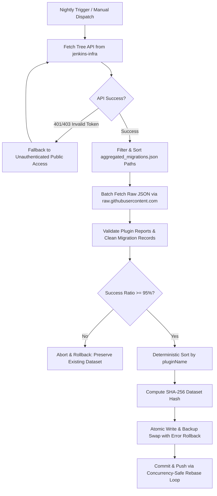

# Data Pipeline & Verification Specification

## Overview
The ingestion pipeline runs autonomously via GitHub Actions (`.github/workflows/sync-plugin-data.yml`) on a nightly schedule. It extracts telemetry from the upstream `jenkins-infra/metadata-plugin-modernizer` repository and compiles the data for client-side analytical consumption.

---

## Ingestion Architecture (`scripts/fetchData.mjs`)

---

## Error Handling Matrix

| HTTP Status | Category | Pipeline Behavior |
|---|---|---|
| **400 Bad Request** | Permanent Client Error | Aborts immediately without retry loop. |
| **401 Unauthorized** | Authentication Error | Drops token, attempts unauthenticated retry, suppresses token in logs. |
| **403 Rate Limit** | Client Quota Error | Parses `x-ratelimit-reset` timestamp, aborts without retry if quota exhausted. |
| **404 Not Found** | Missing Resource | Aborts immediately without retry loop. |
| **408 Timeout** | Transient Request Error | Retries with exponential backoff and randomized jitter (up to 3 attempts). |
| **422 Unprocessable** | Permanent Data Error | Aborts immediately without retry loop. |
| **429 Too Many Requests**| Rate Limit Hit | Respects `retry-after` header, adds jitter, retries up to 3 times. |
| **500, 502, 503, 504** | Transient Server Error| Retries with exponential backoff and randomized jitter (0–500ms). |

---

## Independent Verification (`scripts/verifyData.mjs`)

To guarantee dataset integrity during CI quality gates and local builds, `scripts/verifyData.mjs` executes independently of the application:

1. **Cryptographic Checksum Verification**:
   - Recomputes SHA-256 of `src/data/all_plugins.json` with normalized line endings (`replace(/\r\n/g, '\n')`).
   - Asserts computed hash matches `manifest.datasetSha256`.
2. **Schema & Count Consistency**:
   - Asserts `all_plugins.json` is a non-empty JSON array.
   - Asserts plugin count equals `manifest.successfulCount`.
   - Asserts `manifest.successRatio >= 0.95`.
3. **Case-Insensitive Uniqueness**:
   - Asserts all plugin names are unique (e.g. `git` and `Git` are flagged as duplicates).
4. **Structural Validity**:
   - Verifies each plugin record has a non-empty `pluginName` and an array of `migrations`.

---

## CI/CD Workflow Execution

- **`sync-plugin-data.yml`**:
  - Uses `contents: write` in the sync job, and outputs `deploy_sha=$(git rev-parse HEAD)`.
  - The publication job checks out `ref: ${{ needs.fetch-and-sync.outputs.deploy_sha }}` to prevent deploying stale data.
  - Concurrency group `ecosystem-sync` prevents concurrent ingestion conflicts.
- **`ci.yml`**:
  - Dedicated PR verification gate triggering on pull requests to `main`.
  - Runs `npm ci`, `npm audit --omit=dev --audit-level=high`, `npx eslint .`, `npx tsc -b`, `npm test`, `node scripts/verifyData.mjs`, and `npx vite build`.
